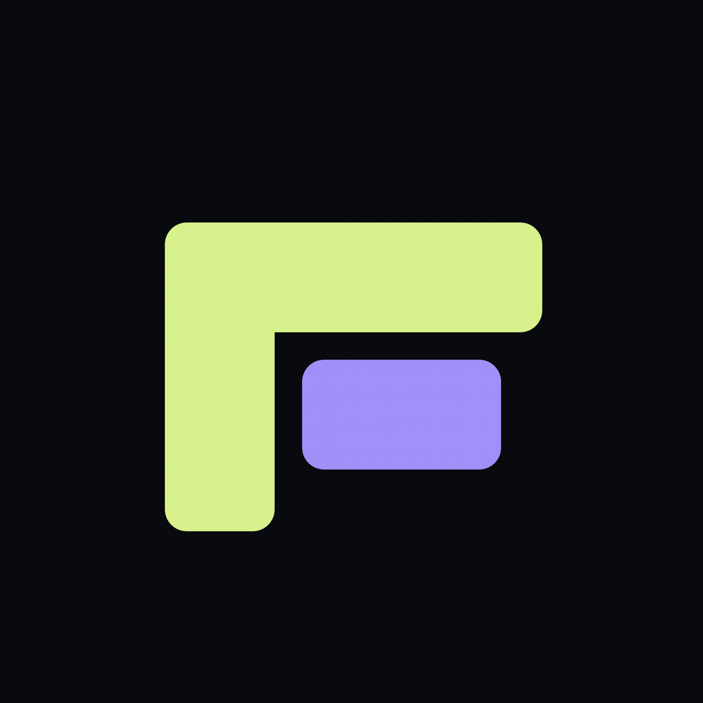
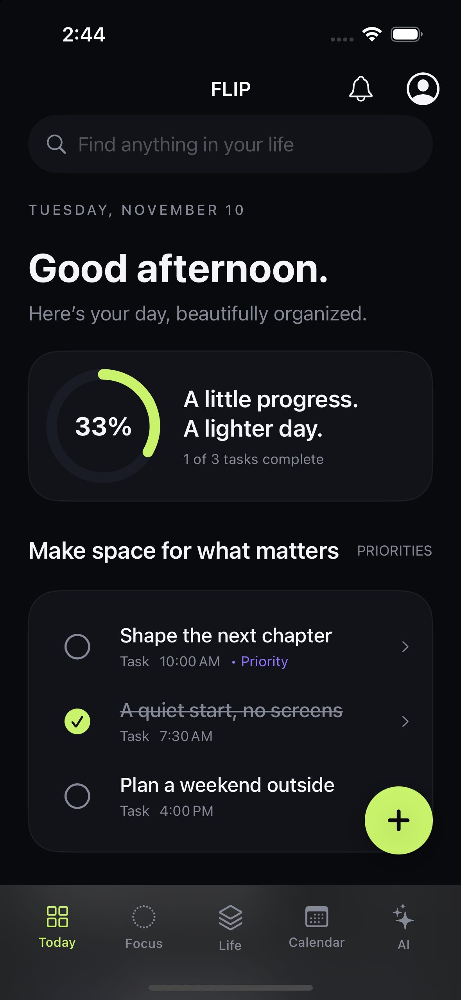
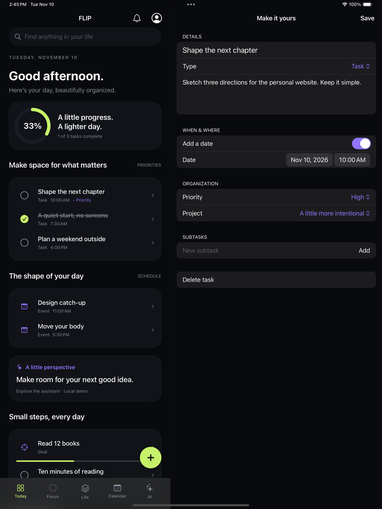
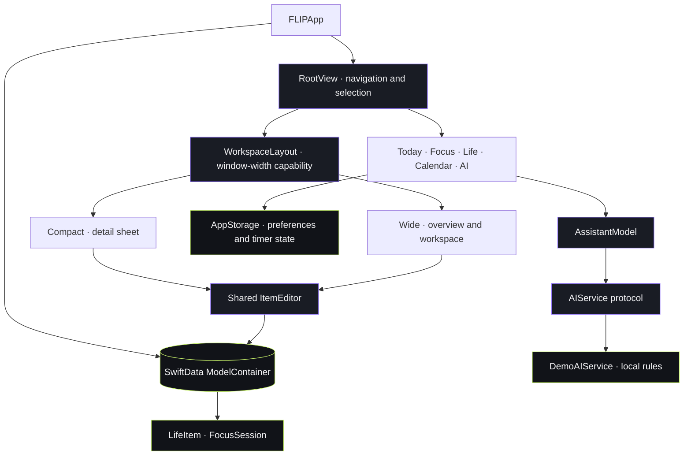

<div align="center">



# FLIP

### Everything in your life. One clear view.

**A calmer day. A focused mind. A little more room to live.**

A native personal organizer for iPhone and iPad.<br>
Bring your tasks, projects, habits, notes, and schedule into one thoughtful workspace.

[](FLIP/)
[](FLIP/Views/)
[](FLIP/Models/LifeItem.swift)
[](project.yml)

[](https://github.com/Skeeb32/filp)
[](https://github.com/Skeeb32/filp/forks)
[](https://github.com/Skeeb32/filp/commits/)

[**See it in action**](#a-place-for-your-whole-day) · [**Run locally**](#quick-start) · [**Explore the engineering**](#under-the-interface) · [**Contribute**](#build-the-next-chapter)

</div>

---

## A place for your whole day

<table>
  <tr>
    <th align="center">iPhone · Your day at a glance</th>
    <th align="center">Duo workspace · Context stays in view</th>
  </tr>
  <tr>
    <td align="center" width="36%"><a href="docs/iphone-today.png"></a></td>
    <td align="center" width="64%"><a href="docs/duo-workspace.png"></a></td>
  </tr>
</table>

<p align="center"><sub>Actual simulator captures from the app. Open either image for the full-resolution view.</sub></p>

**One-handed when you need it. Side by side when you have the space.**

On compact windows, task details open in a sheet. On wide windows, the overview remains beside an editable workspace. Select a task, event, or project—or drag a supported row into the workspace—to bring its details into focus.

> [!NOTE]
> **What “Duo” means here:** an adaptive two-pane experience on supported window sizes, demonstrated on iPad. It does not require—or claim integration with—a proprietary dual-display API.

## Less switching. More doing.

A task lives in one place. Its notes live somewhere else. Your calendar explains when you are busy, but not what deserves your attention.

FLIP brings those pieces together: capture a thought, connect it to a project, choose when it matters, and give it a focused block of time. The interface keeps the next action close while leaving room for the rest of your day.

| At a glance | In the repository |
| :--- | :--- |
| **5 primary screens** | Today, Focus, Life, Calendar, and AI |
| **10 capture types** | Tasks, notes, ideas, reminders, events, goals, projects, habits, milestones, and routines |
| **0 third-party package dependencies** | Native Apple frameworks; no package installation required to run |
| **8 automated tests** | 5 model/service tests and 3 UI tests; documented iPhone run passed |
| **1 additional device check** | Workspace UI test also passed on iPad |

Test counts describe the [recorded verification](docs/VERIFICATION.md), not a continuously running CI status.

## Built around the way a day unfolds

| Space | What you can do |
| :--- | :--- |
| **☀️ Today** | See daily task completion, priority tasks, an unscheduled inbox, events, habits, goals, and upcoming commitments. Search titles and notes. |
| **◉ Focus** | Pick a task or start an open session. Pause, resume, and return after a relaunch with the timer state preserved. Review completed sessions. |
| **🌱 Life** | Organize projects and subtasks, track daily habit check-ins, keep notes and ideas, and update goals, milestones, and routines. |
| **▦ Calendar** | Switch between month and week views, move between dates, and inspect the selected day’s agenda. |
| **✦ AI** | Explore a conversational interface with suggestions, loading/error states, and an opt-in context boundary. Replies come from an explicitly labeled local demo. |
| **＋ Smart Capture** | Create any supported item from anywhere in the app. Add a date, priority, notes, or project; reopen it to edit or delete. |

### Small details that make the difference

- **Your work survives a restart.** SwiftData stores organizer items and completed focus sessions; `@AppStorage` stores preferences and timer state.
- **Editing has a clear commit point.** Main editor fields stay in a draft until **Save**. Failed saves roll back the context and show an error.
- **Parents can go; children can stay.** Deleting a project or parent task clears matching UUID references while preserving child items.
- **Progress has a daily context.** Task completion is calculated for the selected day; habits record calendar-day check-ins.
- **The design has a vocabulary.** Almost-black surfaces, purple assistant accents, lime progress states, native typography, reusable cards, and restrained materials.
- **Interaction respects preferences.** Completion haptics can be disabled; navigation and completion animations respect Reduce Motion. Accessibility labels and scalable typography are included, with further device and assistive-technology review still on the roadmap.

## Quick start

### 1 · Get the project

You need **macOS, a full Xcode installation, and an installed iOS simulator runtime**. The deployment target is **iOS 17.0**. The recorded build used **Xcode 27.1**, with the complete test suite run on **iOS 17.5**; other Xcode versions have not been verified here.

```sh
git clone https://github.com/Skeeb32/filp.git
cd filp
open FLIP.xcodeproj
```

The repository slug is `filp`; the app and Xcode scheme are named **FLIP**.

### 2 · Run

1. Select the **FLIP** scheme in Xcode.
2. Choose an installed **iPhone simulator** as the run destination.
3. Press **⌘R**.
4. Explore the sample day, then capture something of your own with **＋**.

**No API key, account, `.env` file, backend, or package-install step is required.** Sample content is inserted once when the app first opens an empty store. Your changes persist locally.

To explore Duo, run on an **iPad simulator** with a wide enough app window. The current layout switches to two panes at **850 points**, a window-width capability defined in [`WorkspaceLayout`](FLIP/Design/WorkspaceLayout.swift).

### 3 · Make it yours

Open the profile icon to set your display name, toggle haptics, adjust the focus duration from **5–120 minutes**, or change the assistant’s context-sharing preference.

<details>
<summary><strong>Command-line build and test</strong></summary>

Check which Xcode and destinations are available:

```sh
xcodebuild -version
xcodebuild -project FLIP.xcodeproj -scheme FLIP -showdestinations
```

Build for the simulator without device signing:

```sh
xcodebuild \
  -project FLIP.xcodeproj \
  -scheme FLIP \
  -destination 'generic/platform=iOS Simulator' \
  CODE_SIGNING_ALLOWED=NO \
  build
```

Run tests on an installed simulator. Replace `YOUR_SIMULATOR_UDID` with an iOS simulator identifier from the destination list:

```sh
xcodebuild \
  -project FLIP.xcodeproj \
  -scheme FLIP \
  -destination 'platform=iOS Simulator,id=YOUR_SIMULATOR_UDID' \
  -parallel-testing-enabled NO \
  CODE_SIGNING_ALLOWED=NO \
  test
```

In Xcode, **Product → Test** or **⌘U** runs the same scheme’s test targets. UI tests expect the seeded sample task to be present; use a dedicated simulator for testing.

</details>

<details>
<summary><strong>Project generation, physical devices, and distribution</strong></summary>

The Xcode project is checked in, so XcodeGen is optional for running the app. If you change target configuration, edit [`project.yml`](project.yml) and regenerate using an installed [XcodeGen](https://github.com/yonaskolb/XcodeGen):

```sh
xcodegen generate
```

Review and commit the resulting project-file changes alongside the configuration change.

For a physical device:

1. Select the **FLIP** app target in Xcode.
2. Open **Signing & Capabilities**.
3. Choose your development team and a bundle identifier you can sign.
4. Select your connected iPhone or iPad and run.

For distribution, configure signing and versioning, then use Xcode’s **Product → Archive** with a device destination. App Store/TestFlight distribution, release automation, and release-readiness validation are not configured in this repository.

</details>

## Try a complete workflow

1. **Capture:** tap **＋**, enter “Sketch the portfolio homepage,” choose **Task**, and save. With no date, it appears in Today’s inbox.
2. **Organize:** create a **Project**, then reopen the task and assign it to that project. Add notes and subtasks from the editor.
3. **Schedule:** enable **Add a date**, choose a time, and save. Find the item in Calendar’s agenda for that day.
4. **Focus:** select the task in Focus and begin a session. Pause when needed; completed sessions appear in the history. Ending early discards the session.
5. **Review:** mark the task complete and check in on a habit. Daily completion and habit history update locally.

Typing **“Gym tomorrow at 7 AM”** preserves that text as the title. Choose the date explicitly—the current capture implementation does not interpret natural-language dates.

## Under the interface

FLIP uses SwiftUI-managed state and SwiftData models, with a dedicated observable model for asynchronous assistant requests. The UI, persisted domain, design components, and service boundaries are organized separately.



### Engineering decisions worth exploring

| Decision | Why it matters | Read the implementation |
| :--- | :--- | :--- |
| **A typed organizer model** | `ItemKind` shares capture and editing behavior across ten item types; UUIDs associate projects and subtasks. | [`LifeItem.swift`](FLIP/Models/LifeItem.swift) |
| **One editor, two presentations** | Compact and wide layouts use the same editor, keeping field behavior and persistence consistent. | [`RootView.swift`](FLIP/Views/RootView.swift) · [`ItemEditor.swift`](FLIP/Views/ItemEditor.swift) |
| **A persisted focus deadline** | Remaining time is calculated from a saved deadline, rather than relying only on a foreground countdown. | [`FocusView.swift`](FLIP/Views/FocusView.swift) |
| **An injectable assistant service** | `AssistantModel` accepts an `AIService`; async requests expose loading and error states independently of a future provider. | [`AssistantView.swift`](FLIP/Views/AssistantView.swift) · [`Services.swift`](FLIP/Services/Services.swift) |
| **An explicit context boundary** | Assistant context is opt-in and limited to today’s unfinished task titles and event titles. | [`AssistantView.swift`](FLIP/Views/AssistantView.swift) |
| **Recoverable save failures** | Editors roll back failed saves; startup errors show a recovery message without deleting the store. | [`ItemEditor.swift`](FLIP/Views/ItemEditor.swift) · [`FLIPApp.swift`](FLIP/FLIPApp.swift) |

<details>
<summary><strong>Repository map</strong></summary>

```text
FLIP/
├── FLIPApp.swift              App entry point and persistence container
├── Models/LifeItem.swift      Organizer records, focus sessions, day logic
├── Design/                   Palette, shared components, layout policy
├── Services/Services.swift    AI and capture interfaces, demo provider, seed data
├── Views/                    App shell, screens, settings, shared editor
├── Assets.xcassets/           App icon
└── PrivacyInfo.xcprivacy      Privacy manifest
FLIPTests/                    Model, persistence, and service tests
FLIPUITests/                  Capture, navigation, focus, calendar, workspace tests
docs/                         Real screenshots and verification notes
FLIP.xcodeproj/               Ready-to-open Xcode project
project.yml                   XcodeGen project configuration
```

</details>

## Honest intelligence. Clear boundaries.

FLIP is a functional local app with an **AI integration foundation**. Its current assistant is a **rule-based development demo**, with that label visible in the interface and replies.

| Area | Available now | Future integration work |
| :--- | :--- | :--- |
| **Assistant** | Conversation UI, suggestions, async service abstraction, local demo | Real provider, provider-specific consent, secure credentials, generated-plan review |
| **Capture** | Typed records, literal text capture, explicit dates | Natural-language date interpretation through the parser boundary |
| **Calendar & reminders** | FLIP-local records and agenda views | EventKit authorization, external calendar access, system notifications |
| **Storage** | Device-local SwiftData persistence | Cloud accounts, synchronization, conflicts, and migration policies |
| **Duo** | Adaptive two-pane layout and supported row drag/drop | Actual multi-display scene coordination when appropriate APIs are available |

The current demo makes **no network requests**. Context sharing is off by default; even when enabled, notes, locations, and attendees are not included in the assistant context. The [privacy manifest](FLIP/PrivacyInfo.xcprivacy) declares no tracking or collected data and documents the app’s UserDefaults access.

To connect a real provider, implement [`AIService`](FLIP/Services/Services.swift), inject it into `AssistantModel`, and add provider-specific disclosure and consent before sending data. Keep provider secrets out of the app binary. The capture parser protocol is also defined, but the current editor directly uses `LiteralCaptureParser`; a production parser still needs to be wired into that call site.

## Verification and project activity

The badges at the top query GitHub stars, forks, and last-commit activity through Shields.io. The technical evidence lives in the source and [verification report](docs/VERIFICATION.md).

| Recorded check · November 10, 2026 | Result |
| :--- | :--- |
| **iPhone 15 Pro · iOS 17.5** | 8 tests passed, 0 failures |
| **iPad Pro 13-inch (M4) · iOS 17.5** | Workspace selection test passed |
| **Persistence** | Disk-backed store reopened; saved data and deletion checked |
| **User flows** | Capture, relaunch persistence, five-tab navigation, focus controls, calendar controls, and task-detail selection exercised |

**Project status:** automated CI, published coverage reports, performance benchmarks, and App Store distribution are not configured or documented. Physical-device, manual VoiceOver, largest Dynamic Type, and additional resizing/drag-drop checks remain release-validation work.

Browse the [commit history](https://github.com/Skeeb32/filp/commits/), [contributors](https://github.com/Skeeb32/filp/graphs/contributors), and [open issues](https://github.com/Skeeb32/filp/issues) for live project activity.

## The next chapter

The implemented foundation is checked below. Unchecked items are proposed directions and contribution opportunities—not a dated delivery commitment or a claim that work is already underway.

- [x] Five-screen native app with a cohesive dark design system
- [x] Local task, project, note, event, and habit management
- [x] Shared capture/editor, search, preferences, and persisted focus state
- [x] Adaptive overview/workspace layout with compact fallback
- [x] Labeled assistant demo and service interfaces
- [x] Model/service tests and simulator UI verification
- [ ] Automated CI and published coverage reporting
- [ ] Expanded accessibility, physical-device, and resizing validation
- [ ] Real AI provider with explicit privacy and credential handling
- [ ] Natural-language capture parsing
- [ ] Authorized calendar integration and system reminders
- [ ] Cloud synchronization and conflict handling
- [ ] Distribution setup and release validation

## Build the next chapter

Useful contributions can start small: a clearer empty state, an accessibility improvement, a reproducible bug, or a test for an edge case.

### A straightforward contribution flow

1. **Open an issue** for larger changes so scope and design can be discussed before implementation.
2. **Fork and clone** the repository, then follow the quick start above.
3. **Create a focused branch:**

   ```sh
   git switch -c feat/describe-your-change
   ```

4. **Make the change.** Reuse the existing design tokens and shared editor where appropriate. Keep provider behavior behind service interfaces, and distinguish demo behavior from connected functionality.
5. **Validate it.** Run the relevant tests; check compact and wide layouts for UI changes. Regenerate the Xcode project if you modify `project.yml`.
6. **Open a pull request** describing the problem, resulting behavior, validation, and any limitations. Include screenshots for visual changes.

For bug reports, include the Xcode/iOS version, device or simulator, reproduction steps, expected behavior, and what happened. Use sample data in screenshots and logs; remove personal information and credentials.

**Licensing:** no license file is currently included. Contact the maintainer about licensing and reuse terms.

## For engineers and hiring teams

FLIP is a compact case study in **native product development across UI, state, persistence, service design, and testing**. It demonstrates:

- **SwiftUI composition:** shared components, adaptive presentation, navigation state, and coordinated selection.
- **Data modeling:** SwiftData records, UUID associations, daily habit history, and date-scoped progress calculations.
- **State recovery:** persisted focus deadlines and preferences, local store recovery messaging, and save rollback paths.
- **Asynchronous design:** an observable, main-actor assistant model with a `Sendable` service protocol and explicit loading/error states.
- **Verification:** XCTest model/service checks and UI automation that crosses save, relaunch, navigation, and device-layout boundaries.

For a fast technical review, start with [`RootView`](FLIP/Views/RootView.swift), [`ItemEditor`](FLIP/Views/ItemEditor.swift), [`FocusView`](FLIP/Views/FocusView.swift), and the [tests](FLIPTests/FLIPTests.swift). These show the implementation tradeoffs directly.

---

<div align="center">

### Make room for what matters.

If FLIP sparks an idea, **give it a star**, try it in the simulator, or help shape its next chapter.

[**⭐ Star FLIP**](https://github.com/Skeeb32/filp) · [**🍴 Fork it**](https://github.com/Skeeb32/filp/fork) · [**🐛 Report an issue**](https://github.com/Skeeb32/filp/issues/new) · [**↗ Share the project**](https://github.com/Skeeb32/filp)

Built by [Skeeb32](https://github.com/Skeeb32) · Swift · SwiftUI · SwiftData

</div>
